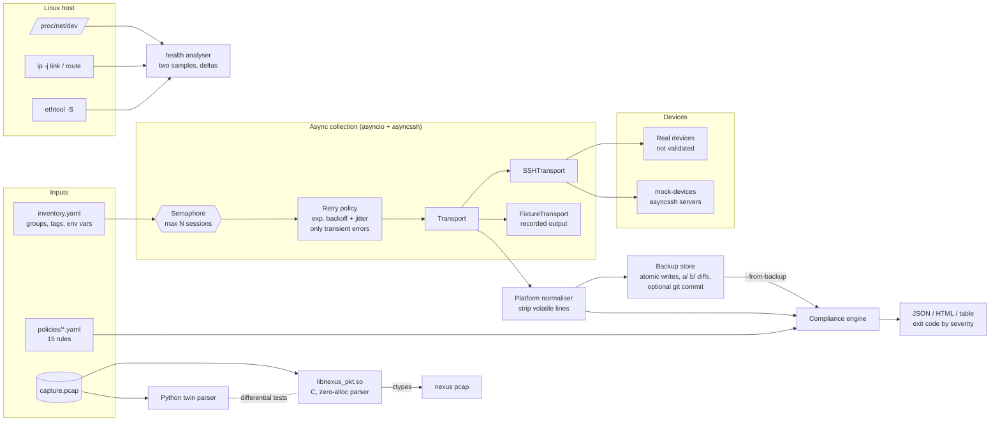

# NEXUS: network automation and packet tooling

[](https://github.com/tommyshamamba/nexus-network-automation/actions/workflows/ci.yml)

NEXUS is a small toolkit for routine network operations:

- pull running configs from many devices over SSH at the same time;
- keep them as versioned backups and show what changed;
- check them against written policies;
- check the network health of a Linux host;
- read a packet capture with a bounds-checked C parser.

It is a portfolio and learning project. It runs against **fake SSH devices** that ship with the repo, and it has **not been validated against real Cisco, Arista or Juniper hardware**. See [Limitations](#limitations).

```
nexus inventory | backup | comply | health | pcap | mock-devices
```

## The problem

Config drift is a common cause of outages. A switch still accepts telnet on VTY lines. A router lost its second NTP server. A trunk is missing the management VLAN. These are easy to find on one box and tedious to find on fifty. A useful tool here has to:

1. **Reach many devices at once**, without opening hundreds of SSH sessions or letting one slow device stall the run.
2. **Survive partial failure.** An unreachable switch should be reported, not crash the run or block everyone else.
3. **Separate real changes from noise.** Timestamps and NVRAM counters change on every pull; a config diff should not.
4. **Express policy as data** (YAML), produce reports that both machines (JSON) and people (HTML) can read, and give CI-friendly exit codes.
5. **Never store secrets in the inventory.**

The same habits apply on the host side, where the issues are links with no carrier, MTU mismatches between a bond and its members, and drop counters creeping up. They also apply to the data plane, where you parse untrusted bytes without crashing and without allocating per packet.

## Architecture



| Path | What it does |
|---|---|
| `src/nexus/inventory.py` | Parses the YAML inventory. Handles defaults and groups, `${VAR:-default}` expansion, and selection by name, group or `tag=value`. It reports **every** problem at once and rejects plaintext `password:`. |
| `src/nexus/collector.py` | Runs `asyncio` fan-out bounded by a semaphore, with a per-device timeout. Auth, host-key and command errors are permanent; connect errors and timeouts are retried with backoff and jitter. |
| `src/nexus/transport.py` | `SSHTransport` (asyncssh) and `FixtureTransport`, which replays recorded CLI output with the same interface. |
| `src/nexus/platforms.py` | Per-platform config commands (`cisco_ios`, `arista_eos`, `juniper_junos`) and regexes for volatile lines. |
| `src/nexus/backup.py` | Atomic writes (temp file, then `rename`, mode 0600), git-style unified diffs, an optional git commit per run, and a run manifest. |
| `src/nexus/compliance.py` | Rule types: `must_match`, `must_not_match`, `count`, `section_must_contain`, `vlans_present` and `vlans_absent`. Each rule has severity, platform scoping, evidence with line numbers, and remediation. |
| `src/nexus/report.py` | JSON, HTML (all device text escaped) and plain-text reports. |
| `src/nexus/health.py` | Host health from two `/proc/net/dev` samples plus `ip -j link`, `ip -j route` and `ethtool -S`. Any of these can be absent, and every input is injectable for tests. |
| `csrc/` | `libnexus_pkt`: a C11 pcap and frame parser with a flow table, built with CMake. Includes a C unit test binary and the C-only `nx-pcapstat` tool. |
| `src/nexus/pcap.py` | The ctypes binding plus a pure-Python twin of the same parser. |
| `src/nexus/mockdev.py` | Fake SSH devices: real asyncssh servers that answer commands from fixture files. They support password auth and an artificial delay for timeout tests. |

### The C data-plane module (`csrc/`)

`libnexus_pkt` is written the way packet-path code usually is:

- **No allocation per packet.** The caller owns the frame buffer, the result struct and the flow-table storage.
- **Every header read is bounds-checked** against the captured length. A truncated or inconsistent header sets `NX_F_TRUNCATED` or `NX_F_MALFORMED` instead of reading past the buffer.
- **No global state**, so you can run one parser instance per thread or core.
- **Coverage:**
  - Ethernet II, 802.1Q and 802.1ad/QinQ, ARP;
  - IPv4 with header checksum verification and fragment detection;
  - IPv6 with hop-by-hop, routing, fragment and destination-options extension headers;
  - TCP, UDP, ICMP and ICMPv6;
  - classic pcap in either byte order with µs or ns timestamps.
- **Flow table:** open addressing with an FNV-1a 5-tuple hash and a fixed capacity. When it is full, new flows are counted as `dropped` instead of being allocated.
- **Strict build:** `-Wall -Wextra -Wconversion …`, with `NX_WERROR=ON` in CI. `NX_SANITIZE=ON` builds with ASan and UBSan.

Two independent checks keep it honest:

- `csrc/tests/test_nexus_pkt.c` runs **238 checks**. They include truncating a valid frame at every possible length and 20,000 random frames, all run under ASan and UBSan in CI.
- `tests/test_pcap.py` checks the C engine against the Python twin. It runs on the sample capture and on fuzzed and mutated captures (bit flips, cuts, noise, both byte orders, ns timestamps), and also cross-checks protocol counts against [dpkt](https://github.com/kbandla/dpkt) as an unrelated oracle.

The differential test caught a real bug while I was building this. Flows that tied on bytes and packets were sorted in an order that depended on the engine. The fix is in the `_top()` sort key.

## Quickstart

Requires Python 3.12 or newer. A C compiler, CMake and Ninja are optional: without them, `nexus pcap` falls back to the Python engine.

```bash
git clone https://github.com/tommyshamamba/nexus-network-automation
cd nexus-network-automation
python3 -m venv .venv && . .venv/bin/activate
pip install -e '.[dev]'

# optional: build the C library and run its unit tests
cmake -S csrc -B build -G Ninja -DCMAKE_BUILD_TYPE=Release && cmake --build build
ctest --test-dir build --output-on-failure

# full demo against local fake devices (no real gear touched)
./scripts/demo.sh            # writes demo-out/{backups,reports}

pytest -q                    # unit + integration tests
```

Using it on your own inventory:

```bash
export NEXUS_PASSWORD='…'                      # never put it in the YAML
nexus inventory -i inventory.yaml --probe      # TCP reachability
nexus backup    -i inventory.yaml -o backups --git --show-diff --concurrency 20
nexus comply    -i inventory.yaml -p policies/ --from-backup backups \
                --json-out report.json --html-out report.html --fail-on high
nexus health    --interval 2 --expect-mtu bond0=9000
nexus pcap      capture.pcap --top 10
```

**Exit codes:**

- **0** means success.
- **1** means a failure at or above `--fail-on`, or a device that could not be evaluated (pass `--allow-unreachable` to tolerate it).
- **2** means bad input, such as an invalid inventory or policy, a missing file, or a bad flag.

### Docker

```bash
docker build -t nexus .                         # builds + ctests the C lib in a builder stage
docker run --rm nexus pcap examples/pcap/sample.pcap

# two containers: fake devices + a runner that backs up, diffs and checks compliance
NEXUS_PASSWORD=$(openssl rand -hex 12) docker compose up --build --abort-on-container-exit
```

The image runs as a non-root user (uid 10001). CI checks that, and also runs the compose demo across the two containers.

## Sample output

The output below is from a real run of `./scripts/demo.sh` on 27 Oct 2026. The full log is in [`docs/sample-output/demo.log`](docs/sample-output/demo.log), and the reports it wrote are [`compliance.json`](docs/sample-output/compliance.json) and [`compliance.html`](docs/sample-output/compliance.html). The hostname is redacted. Device names are lab fixtures.

Backup after a simulated change on `access-sw1`. `lab-sw-offline` is an inventory entry with nothing listening behind it, so it is retried and then reported:

```text
access-sw1     changed    attempts=1  +6 -2
--- a/access-sw1.cfg
+++ b/access-sw1.cfg
@@ -13,6 +13,7 @@
 ip ssh version 2
 !
 ntp server 10.0.0.10
+ntp server 10.0.0.11
 !
 logging host 10.0.0.20
 !
@@ -45,7 +49,7 @@
  exec-timeout 10 0
 line vty 0 4
  access-class MGMT-ONLY in
- transport input ssh telnet
+ transport input ssh
 line vty 5 15
  transport input ssh
 !
core-sw1       unchanged  attempts=1
edge-rtr1      unchanged  attempts=1
lab-sw-offline failed     attempts=2  cannot connect to 127.0.0.1:2299: [Errno 111] Connect call failed ('127.0.0.1', 2299)

0 new, 1 changed, 2 unchanged, 1 failed -> demo-out/backups; git commit 6c513f7
```

Compliance, collected live over SSH from the mock devices:

```text
DEVICE         PLATFORM         SCORE  PASS  FAIL  SKIP  NOTE
access-sw1     cisco_ios        77.8%     7     2     6  VTY-001, PASS-001
core-sw1       arista_eos      100.0%     6     0     9
edge-rtr1      juniper_junos   100.0%     5     0    10
lab-sw-offline cisco_ios          n/a     0     0     0  connect: cannot connect to 127.0.0.1:2299: ...

2/4 devices compliant; 2 failed checks (high=1, critical=1); 1 not evaluated
```

Host health on a recorded "bad host" fixture. A live run on a quiet VM just reports `status OK`, which is less interesting. This output comes from `tests/data/health/` and is regenerated in [`docs/sample-output/health-fixture.txt`](docs/sample-output/health-fixture.txt):

```text
host fixture-host  window 2.0s  status CRITICAL  default-route yes
IFACE           STATE       MTU         RX         TX  DROPS(new)  ERRS(new)
bond0           UP         9000    4.0Mbps    2.0Mbps           0          7
eth0            UP         9000  100.0Mbps   20.0Mbps          50          0
eth1            DOWN       1500       0bps       0bps           0          0
eth2            UP         1500    4.0Mbps    2.0Mbps           0          7
...
[WARNING ] drops_increasing         eth0         50 new drops in 2.0s (0.167% of 30000 packets)
[WARNING ] nic_counters_increasing  eth0         rx_missed_errors+50
[CRITICAL] link_down                eth1         administratively up but no carrier / oper state DOWN
[WARNING ] mtu_member_mismatch      eth2         MTU 1500 differs from master bond0 (9000)
[CRITICAL] errors_increasing        eth2         7 new rx/tx errors in 2.0s
[WARNING ] route_via_down_link      eth1         route 10.9.0.0/24 uses a link that is down
[INFO    ] bridge_no_ports          docker0      bridge is up but has no active member ports
```

Packet capture through the C engine. `examples/pcap/sample.pcap` is synthetic, generated by `nexus.pcapgen`, and includes deliberately broken frames:

```text
packets 204  wire bytes 155693  captured bytes 155173  span 0.472s
  ipv4=176  ipv6=20  arp=8  other_l3=0  tcp=144  udp=38  icmp=14  other_l4=0  vlan_tagged=34  qinq=6  fragments=2  bad_ipv4_csum=1  truncated=1  malformed=0

flows 12 (untracked: 0); top 5 by bytes:
  tcp                  10.0.10.5:51514 -> 10.0.20.8:443                      95 pkts    119130 B
  tcp                  10.0.20.11:7000 -> 10.0.20.12:7001                    28 pkts     24024 B
  tcp              [2001:db8::1]:40000 -> [2001:db8::2]:8443                 20 pkts      7480 B
  udp                  10.0.10.5:53001 -> 10.0.0.53:53                       13 pkts      1066 B
  udp                   192.0.2.1:4789 -> 192.0.2.2:4789                      6 pkts       900 B
```

## Testing

| Suite | What it covers |
|---|---|
| `ctest` / `test_nexus_pkt` (238 checks) | Checksums; VLAN/QinQ; IPv4 fragments and bad IHL; IPv6 extension headers; ARP; truncation at every byte length; malformed lengths; pcap LE/BE/ns; file errors; flow-table capacity and drop accounting; 20k random frames. In CI it runs under gcc and clang, each with and without ASan+UBSan. |
| `pytest` (89 tests) | Inventory validation, including a test that every problem is reported at once. Concurrency limit, retry and permanent-error paths. Real SSH against mock devices: wrong password, timeouts, refused port, and host-key rejection with strict checking. Backup diffs, volatile-line filtering, git failures. Every rule type. HTML escaping. Health analysis on fixtures, including counter resets. C vs Python differential fuzzing. CLI exit codes. |
| CI also runs | ruff (lint + format) · mypy `--strict` on `src/` · the demo script with assertions on its output · the Docker image and compose demo · gitleaks over full history · pip-audit |

## Limitations

These are deliberate and honest:

- **Not validated on real hardware.** Platform commands and volatile-line patterns come from vendor documentation and typical output. Only the mock devices and the recorded fixtures exercise them.
- **Exec channel only.** Commands run over an SSH exec channel. There is no interactive shell, paging (`terminal length 0`), `enable` mode, or vendor prompt handling, so devices that require them won't work yet. Using netmiko or scrapli as an optional transport would be a natural next step.
- **No config push.** It is read-only by design. Remediation text is advice, not automation.
- **Regex-based compliance.** Rules match normalised text, not a parsed config model. `section_must_contain` understands indentation-based sections (IOS and EOS style), not Junos hierarchy. Junos is handled through `display set` output.
- **Host keys.** `strict_host_key: true` (the default) uses `~/.ssh/known_hosts`. The demo inventory turns it off because the fake devices create a new key on every start. Don't copy that to real inventories.
- **Health checks** cover one host and one sampling window. There is no daemon, history or alerting. `ethtool` counter names vary by driver, so only common error and drop counters are checked.
- **The packet parser** reads classic pcap with Ethernet link type only: no pcapng, no live capture, no reassembly, no TCP state. It is single-threaded, and the flow table is fixed-size and never evicts.
- **DPDK is not used.** DPDK is a *possible future extension*: put the same zero-alloc parser behind an `rte_mbuf` burst loop (`rte_eth_rx_burst`), with one flow table per lcore and RSS spreading flows across queues. The parser's caller-owned buffers and lack of global state were chosen with that in mind, but none of it has been built or tested.

## How this maps to network and data-plane engineering

| Concern in production networks | Where it appears here |
|---|---|
| Bounded parallelism toward fragile control planes | Semaphore-limited fan-out and per-device timeouts in `collector.py` |
| Telling transient faults from permanent ones | Retry only connect errors and timeouts; fail fast on auth, host-key and command errors |
| Config drift and change review | Normalised backups, `a/` `b/` unified diffs, git history per run |
| Policy as code, CI gating | YAML rules with severity, `--fail-on`, and JSON for pipelines |
| Linux networking internals | `/proc/net/dev` counter deltas, `ip -j` link and route state, bond/bridge semantics, MTU consistency, NIC counters through `ethtool -S` |
| Safe parsing of untrusted packets | Bounds-checked C parser; truncation at every length; fuzzed against a second implementation; sanitizers in CI |
| Fast-path discipline | No per-packet allocation, caller-owned memory, fixed-capacity flow table with drop accounting, no global state |
| Wire formats | 802.1Q and QinQ, IPv4 checksum and fragments, IPv6 extension-header walk, L4 port extraction |
| Operability | Clear exit codes, partial-failure reporting, atomic writes, secrets only from the environment |

## Security notes

- Passwords are read only from the environment variable named by `password_env`. An inventory containing `password:` is rejected.
- Backups are written with mode `0600`, because device configs often contain hashes and SNMP communities.
- Device output in HTML reports is escaped.
- CI runs gitleaks over the full git history and pip-audit over the dependencies.

## License

MIT
